# Open Pocket GBC

**Game Boy / Game Boy Color for the Sipeed Tang Nano 20K: HDMI, an Analogue Pocket-style menu, games from an SD card or the on-board flash, working saves, an optional SPI LCD and speaker, built only with open-source tools.**

**Website:** https://lakomoor.github.io/open-pocket-gbc/ · [Русская версия](docs/README.ru.md) · Sister project: [Open Pocket WS](https://github.com/LakoMoor/open-pocket-ws) (WonderSwan Color)

**Experimental Open Pocket GBA:** `./build.sh gba_top` builds a separate ARM/Thumb,
SDRAM and Mode 3 diagnostic configuration. This is an incomplete GBA port; see
[tested progress](docs/gba-progress.md), [architecture](docs/gba-architecture.md),
[memory budget](docs/gba-memory-budget.md) and [limitations](docs/gba-compatibility.md).

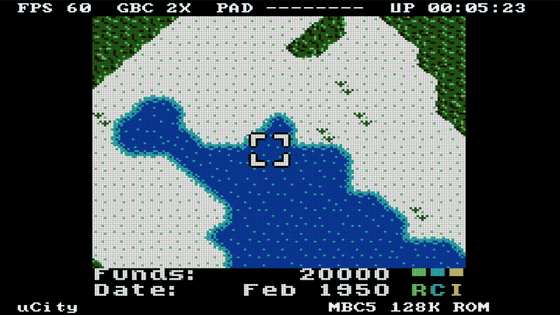

The MiSTer Game Boy core runs natively on the 20K's GW2AR-18 FPGA. Video goes out over HDMI (480p, 3× scaling, with audio) and, at the same time, to a cheap 1.44" ST7735S LCD. A small RISC-V CPU inside the FPGA runs the menu firmware: it loads games from a microSD card or the on-board SPI flash, writes cartridge saves and keeps the settings. Every step from source to bitstream uses open-source tools: yosys + slang, GHDL, nextpnr-himbaechel, Apicula and openFPGALoader. No Gowin IDE is needed.

| Menu | Display settings | Info |
|---|---|---|
| 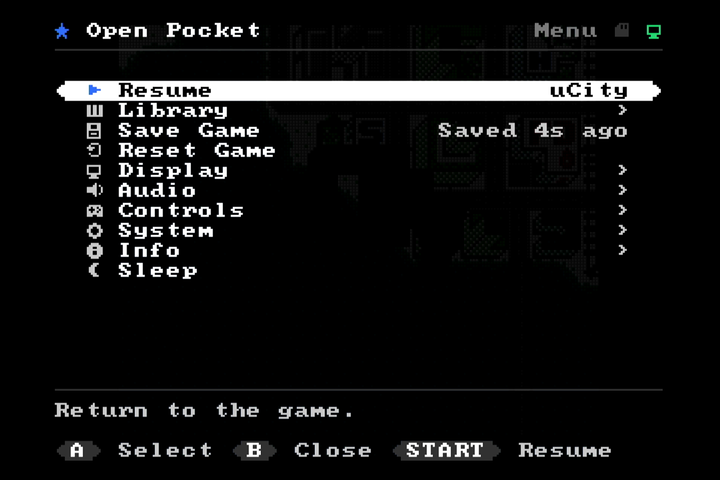 | 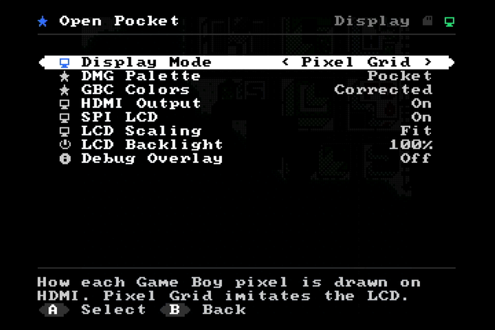 | 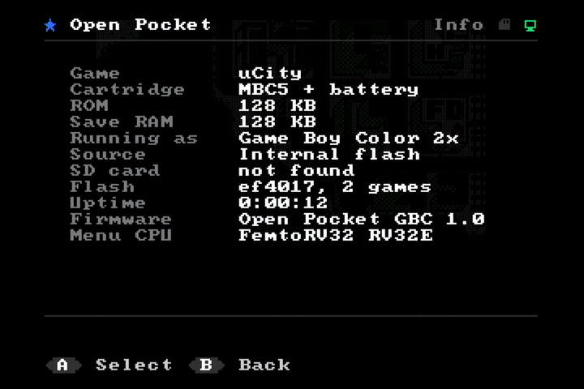 |

## Features

- **Core:** MiSTer Gameboy core with GB and GBC modes, double speed, HDMA and audio. MBC1/2/3/5, HuC1/HuC3 and plain-ROM carts are supported.
- **HDMI:** 720×480p, 59.94 Hz. The GB picture is scaled 3× to 480×432. Audio is embedded (48 kHz stereo). 720p is a build option.
- **Pocket-style display modes:** *Sharp*, *LCD grid*, *Scanlines*. Five DMG palettes. GBC LCD color correction, which can be turned off.
- **Analogue Pocket-style menu:** full-screen list with icons, a rounded selection bar, descriptions and button hints over the dimmed game. Pages: Library, Save Game, Reset, Display, Audio, Controls, System, Info, Sleep. Short "Saved" / "HDMI off" notifications appear over the running game. See [docs/menu.md](docs/menu.md).
- **Library:** games from a **microSD card** (FAT32 or exFAT, folders, long file names, ROMs up to 6 MB) and from the **internal SPI flash** (up to 15 games). The menu, the flash games, the settings and the saves all work without a card.
- **Saves that survive power-off:** autosave 2 s after the game writes its cartridge RAM, and when the menu opens. SD games get `<rom>.sav` next to the ROM; flash games use a save slot in the flash, and only changed 4 KB sectors are rewritten.
- **Settings are remembered** in the flash: display mode, palettes, volume, model, start-up game, power options.
- **Power saving:** HDMI can be switched off (its PLL is powered down) with a long press on S1 or in the menu, so the board can run on the LCD alone. LCD on/off and backlight level, a sleep mode and sleep timer (game paused, HDMI and LCD off, any button wakes it up), board LEDs off by default, the flash in deep power-down, and the menu CPU sleeps in hardware while the game runs.
- **Buzzer / speaker output:** sigma-delta audio on pins 76 / 75 (a piezo between the two pins, or a small speaker through an amplifier), with DC removal and up to x8 boost.
- **Menu themes:** Ozone (Switch-like sidebar, default), XMB (PS3/PSP category bar), Game Boy (DMG greens), Pocket, Analogue OS, iPod, BIOS setup and Terminal, each with its own SPI LCD layout. Long labels scroll.
- **Home screen:** with no game loaded, a built-in synthwave intro with a chiptune runs behind the menu, as on MiSTer.
- **Power page:** every power saving measure as its own setting, plus Normal / Battery presets.
- **Battery mode:** one switch (System → Power Mode or hold S2) turns off HDMI completely (PLL, tri-stated outputs, no framebuffer traffic), dims the LCD and darkens it after 30 s idle, turns off LEDs and sleeps after 5 min.
- **Cartridge:** an external W25Qxx flash on four pins acts as a game cartridge. Games are written to it from the SD card in the menu, played from it, and keep their saves on it.
- **Original cartridges:** the same four pins drive a five-chip shift-register reader (no microcontroller) for real Game Boy / GBC cartridges, MBC1/2/3/5. The ROM is copied to SDRAM and the battery save goes back to the cartridge: [docs/cart_reader.md](docs/cart_reader.md).
- **SPI LCD menu:** the same Pocket-style look on the 128×128 screen: colour cells, icons, rounded selection bar, title bar and value line.
- **ST7735S 128×128 SPI LCD**, driven together with HDMI at about 60 fps. *Fit* mode filters 160×144 down to 128×115; *Crop* mode shows the center 128×128 at 1:1. The menu is shown on the LCD too.
- **Controls:** DualShock 2 on the Sipeed adapter, 8 plain buttons on header pins, and a **remote over the board's USB-UART**. All three work at the same time.
- **Debug overlay:** FPS, GB/GBC mode, CPU speed, live button state, uptime, game name, mapper and ROM size. It is drawn in the HDMI border and in the top row of the LCD.
- **Menu CPU:** FemtoRV32 (RV32E) with the firmware in SDRAM, FatFs for the card. It stalls on a wait register while nothing happens, so it does not switch during play.

## Demo

| Boot after reset | Loading a game from the Library | Gameplay + live pad state |
|---|---|---|
| 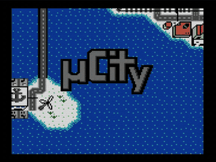 | 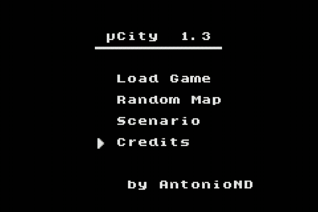 | 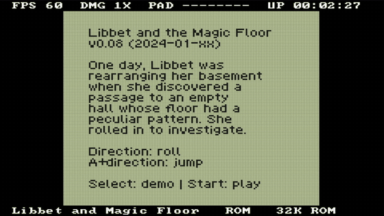 |

Menu navigation, all recorded from the HDMI capture card while `tools/record.py` pressed the buttons over USB:

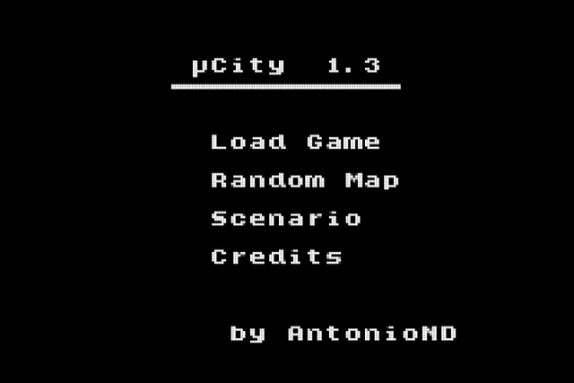

| Display modes (crop, 2×) | DMG palettes (System = DMG) |
|---|---|
| 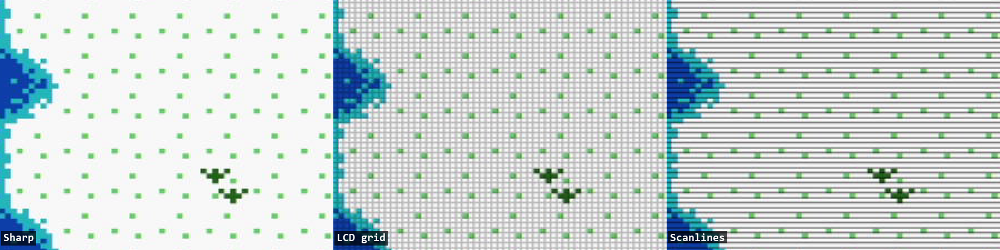 | 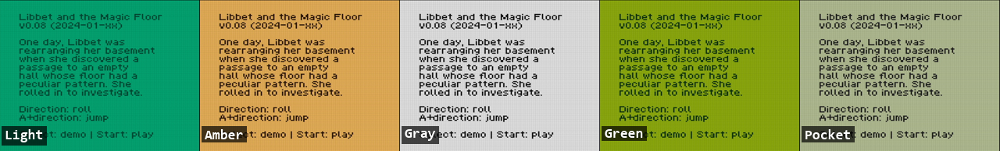 |

LCD output: Fit and Crop. These are simulation renders of the real `lcd_st7735` RTL fed with a captured frame:

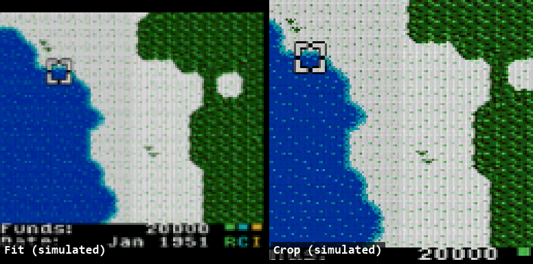

## The die

The design as nextpnr placed it on the GW2AR-18: every used LUT, flip-flop and block RAM at its real position, coloured by block, with the routed wires as traces (`tools/die_shot.py`).

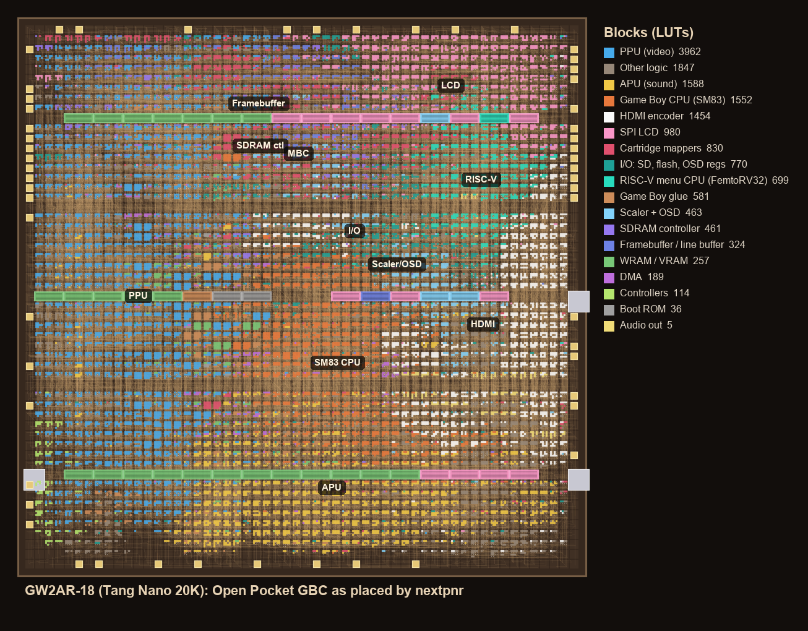

## Quick start

```sh
./build.sh gbc_top                                  # yosys -> nextpnr -> gowin_pack (~10 min)
fw/build.sh                                         # menu firmware (RISC-V GCC)
./flash.sh all                                      # bitstream + firmware to SPI flash
python tools/make_games.py build/games.bin games/ucity.gbc=uCity games/libbet.gb
./flash.sh games                                    # built-in games to flash @ 0x200000
```

For the SD card, copy `.gb` / `.gbc` files (in any folders) to a FAT32 or exFAT microSD card and insert it into the board's slot.

Toolchain setup, build options and the flash layout: [docs/build.md](docs/build.md).

## Controls

| Action | DualShock 2 | GPIO buttons | Board | PC remote (`tools/remote.py`) |
|---|---|---|---|---|
| D-pad | D-pad | Up/Down/Left/Right | | arrows |
| A / B | ○ / ✕ (also △ / □) | A / B | | x / z |
| Start / Select | Start / Select | Start / Select | | Enter / Backspace |
| Open / close menu | Select + Start | Select + Start | **S1** | m |
| HDMI on / off | | | **hold S1** for 1 s | |
| Battery mode on / off | | | **hold S2** for 1 s | |
| Reset game | | | **S2** | r |

In the menu: up/down moves the cursor, left/right changes a value, A selects, B goes back or closes.

## Wiring

Buttons go from each pin to GND; the internal pull-ups are enabled. The LCD runs on 3.3 V.

| Signal | Pin | | Signal | Pin |
|---|---|---|---|---|
| Up | 25 | | LCD SCL | 73 |
| Down | 26 | | LCD SDA | 74 |
| Left | 27 | | LCD RES | 71 |
| Right | 28 | | LCD DC | 72 |
| A | 29 | | LCD CS | 53 |
| B | 30 | | LCD BL | 52 |
| Select | 31 | | DualShock 2 | 17–20 (Sipeed adapter) |
| Start | 77 | | Speaker + / − | 76 / 75 |
| Cartridge CS / CLK | 51 / 48 | | Cartridge DI / DO | 55 / 49 |
| microSD | on-board slot | | HDMI | on board |

Details, LCD orientation and color parameters: [docs/hardware.md](docs/hardware.md).

## Documentation

- [docs/build.md](docs/build.md): toolchain, build, flashing, game images, build switches
- [docs/hardware.md](docs/hardware.md): wiring, LCD module notes, controllers
- [docs/cart_reader.md](docs/cart_reader.md): the original-cartridge reader
- [docs/menu.md](docs/menu.md): every menu item, saves, power saving and the debug overlay
- [docs/remote.md](docs/remote.md): USB-UART remote protocol, scripting, recording GIFs
- [docs/architecture.md](docs/architecture.md): how the port works (clocks, SDRAM, framebuffer, video, the open-source flow)

## Resource usage

| | Used | Available | |
|---|---|---|---|
| LUT4 | 17 242 | 20 736 | 83 % |
| BSRAM | 46 | 46 | 100 % |
| clk_sys 33.75 MHz | Fmax ≈ 46 MHz | | passes |
| clk_pixel 27 MHz (480p) | Fmax > 90 MHz | | passes |

## Status and limitations

- **Tested on hardware with the capture card:** HDMI video and audio path, the new menu, loading and switching games from the flash, flash saves (restored after a reload), settings in the flash, HDMI off / on, sleep and wake-up, DMG/GBC modes, the USB remote.
- **Not yet tested on hardware:** loading and saving on the SD card (the driver and FatFs are in place; no card was inserted during testing) and the speaker output (no buzzer attached).
- **Not tested on hardware:**
  - The ST7735S LCD output is verified in simulation only.
  - The DualShock 2 path is the same as NESTang's, but no controller was attached during testing.
  - The GPIO buttons were only checked for idle state: no false presses with nothing connected.
- **No real-time clock** for MBC3 games, no save states. MBC7 EEPROM saves are not kept.
- **Power was not measured:** the savings above are design measures; no current meter was used.
- **Rare mappers are disabled to save logic:** MBC6, MBC7, MMM01, camera, TAMA5, Rocket, Sachen and MegaDuck. Build with `DEFS="-D ALL_MAPPERS"` to try them; it may not fit.
- **720p is noisy:** the 720p build works but the 371 MHz TMDS link is noisy with the core running, so 480p is the default.

## Credits and licenses

This project is released under the **GPL-3.0** (see [LICENSE](LICENSE)). It includes or is derived from:

- [MiSTer Gameboy core](https://github.com/MiSTer-devel/Gameboy_MiSTer), GPL-3.0: `rtl/gb/` (T80 CPU, PPU, APU, mappers)
- [SameBoy](https://github.com/LIJI32/SameBoy) boot ROMs (MIT), as built by the MiSTer core: `rtl/gb_port/boot_rom.hex`
- [hdl-util/hdmi](https://github.com/hdl-util/hdmi) (MIT / Apache-2.0): `rtl/hdmi/`
- DualShock controller interface by K. Degawa, via [NESTang](https://github.com/nand2mario/nestang): `rtl/io/dualshock_controller.v` (freeware, non-commercial use)
- [font8x8](https://github.com/dhepper/font8x8) (public domain)
- [FemtoRV32 Quark](https://github.com/BrunoLevy/learn-fpga) by Bruno Levy and Matthias Koch (BSD-3-Clause): `rtl/rv/femtorv32_quark.v`, changed to RV32E with the registers in block RAM
- [FatFs](http://elm-chan.org/fsw/ff/) by ChaN (BSD-style): `fw/fatfs/`
- Included homebrew games: [µCity](https://github.com/AntonioND/ucity) by AntonioND (GPL-3.0) and [Libbet and the Magic Floor](https://github.com/pinobatch/libbet) by Damian Yerrick (zlib)

Game Boy and Game Boy Color are trademarks of Nintendo. This project is not affiliated with Nintendo or Analogue.
