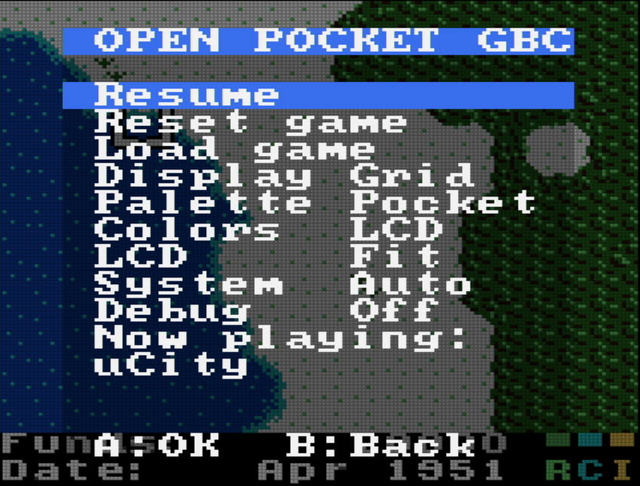
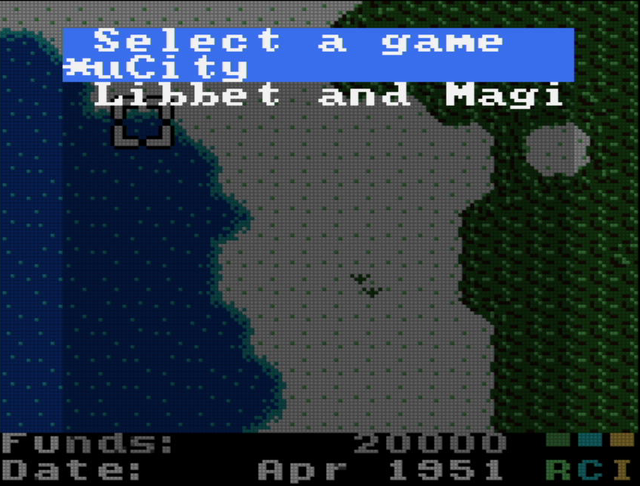
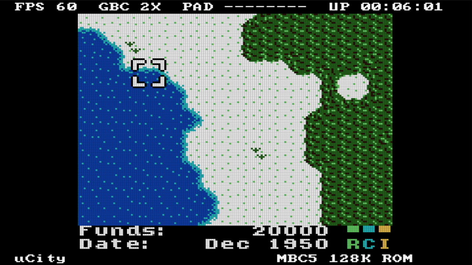

# Open Pocket GBC

**Game Boy / Game Boy Color на Sipeed Tang Nano 20K: HDMI, меню в стиле Analogue Pocket, SPI-дисплей. Собирается только открытыми инструментами.**

[English version](../README.md)


На FPGA GW2AR-18 платы нативно работает ядро Game Boy из MiSTer. Картинка идёт по HDMI (480p, увеличение в 3 раза, со звуком) и одновременно на дешёвый 1.44" дисплей ST7735S. Игры лежат во встроенной SPI-flash и выбираются из экранного меню. Вся цепочка от исходников до прошивки открытая: yosys + slang, GHDL, nextpnr-himbaechel, Apicula, openFPGALoader. Gowin IDE не нужна.

| Меню | Список игр | Debug-режим |
|---|---|---|
|  |  |  |

## Возможности

- **Ядро:** Game Boy из MiSTer, режимы GB и GBC, двойная скорость, HDMA, звук. Мапперы MBC1/2/3/5, HuC1/HuC3, ROM без маппера.
- **HDMI:** 720×480p, 59.94 Гц, картинка GB 480×432, звук 48 кГц стерео. 720p включается опцией сборки.
- **Режимы экрана как у Pocket:** *Sharp*, *LCD grid*, *Scanlines*. Пять палитр DMG. Цветокоррекция GBC, отключаемая.
- **Меню 16×16 символов:** продолжить, сброс, выбор игры, настройки экрана, палитры и цвета, режим LCD, режим системы (Auto / GBC / DMG), debug. Пока меню открыто, игра на паузе и затемнена.
- **SPI-дисплей ST7735S 128×128:** работает одновременно с HDMI, около 60 кадров/с. *Fit* — весь экран со сглаживанием (128×115), *Crop* — центр 1:1. Меню тоже выводится на дисплей.
- **Управление:**
  - DualShock 2 через адаптер Sipeed;
  - 8 обычных кнопок на пинах;
  - пульт с ПК через USB-UART платы.

  Всё работает одновременно.
- **Debug-режим:** FPS, режим GB/GBC, скорость CPU, нажатые кнопки, время работы, имя игры, маппер и размер ROM. Выводится в чёрные поля HDMI и в верхнюю строку LCD.
- **Игры:** до 15 штук во flash с адреса 0x200000, загрузка в SDRAM около секунды.

## Демо

| Загрузка после сброса | Загрузка игры из меню | Игра и нажатые кнопки |
|---|---|---|
|  |  |  |

Все записи сделаны с карты захвата HDMI. Кнопки «нажимал» скрипт `tools/record.py` через USB.


| Режимы экрана (фрагмент, 2×) | Палитры DMG (System = DMG) |
|---|---|
|  |  |

Вывод на LCD в режимах Fit и Crop. Это рендер симуляции настоящего RTL `lcd_st7735` на реальном кадре:


## Быстрый старт

```sh
./build.sh gbc_top                                  # yosys -> nextpnr -> gowin_pack (~8 минут)
./flash.sh flash                                    # прошивка во flash (./flash.sh sram — до выключения)
python tools/make_games.py build/games.bin games/ucity.gbc=uCity games/libbet.gb
./flash.sh games                                    # образ с играми во flash с адреса 0x200000
```

Подробности про тулчейн, драйвер (Zadig, WinUSB на «20K's FRIEND (Interface 0)») и опции сборки — в [build.md](build.md).

## Управление

| Действие | DualShock 2 | Кнопки на пинах | Плата | Пульт с ПК (`tools/remote.py`) |
|---|---|---|---|---|
| Крестовина | крестовина | Up/Down/Left/Right | | стрелки |
| A / B | ○ / ✕ (а также △ / □) | A / B | | x / z |
| Start / Select | Start / Select | Start / Select | | Enter / Backspace |
| Открыть/закрыть меню | Select + Start | Select + Start | **S1** | m |
| Сброс игры | | | **S2** | r |

## Подключение

Кнопки замыкают пин на GND, подтяжка включена внутри FPGA. Дисплей питается от 3.3 В.

| Сигнал | Пин | | Сигнал | Пин |
|---|---|---|---|---|
| Вверх | 25 | | LCD SCL | 73 |
| Вниз | 26 | | LCD SDA | 74 |
| Влево | 27 | | LCD RES | 71 |
| Вправо | 28 | | LCD DC | 72 |
| A | 29 | | LCD CS | 53 |
| B | 30 | | LCD BL | 52 |
| Select | 31 | | DualShock 2 | 17–20 (адаптер Sipeed) |
| Start | 77 | | HDMI | на плате |

**Если картинка на LCD сдвинута, отзеркалена или перепутаны красный и синий:** поправить параметры `MADCTL`, `X_OFS`, `Y_OFS`, `INVERT` у `lcd_st7735`. Подробности — в [hardware.md](hardware.md).

## Документация (на английском)

- [build.md](build.md): тулчейн, сборка, прошивка, образ игр, ключи сборки
- [hardware.md](hardware.md): подключение, дисплей, контроллеры
- [menu.md](menu.md): пункты меню и debug-режим
- [remote.md](remote.md): протокол USB-пульта, скрипты, запись гифок
- [architecture.md](architecture.md): как устроен порт

## Ограничения

- **Дисплей, DualShock 2 и кнопки на железе не проверены.** Дисплей проверен только в симуляции. Без контроллера и кнопок я проверил лишь то, что на пинах нет ложных нажатий.
- **Сохранения пропадают при выключении:** записи RAM картриджа во flash пока нет.
- **Редкие мапперы отключены, чтобы хватило места:** MBC6, MBC7, MMM01, камера, TAMA5, Rocket, Sachen, MegaDuck. Включаются ключом `DEFS="-D ALL_MAPPERS"`, но тогда ядро может не влезть.

## Лицензия

GPL-3.0. Использованные проекты (ядро MiSTer Gameboy, SameBoy boot ROM, hdl-util HDMI, игры µCity и Libbet) и их лицензии перечислены в [README.md](../README.md#credits-and-licenses).
