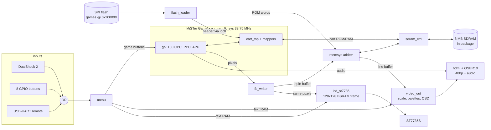

# Architecture



## Clocks

| Clock | Frequency | Source | Domain |
|---|---|---|---|
| `sys_clk` | 27 MHz | crystal | PLL reference |
| `clk_sys` | 33.75 MHz | rPLL (27 × 5/4) | core, SDRAM controller, menu, loader, LCD |
| `clk_sys_p` | 33.75 MHz, 180° | same PLL | SDRAM chip clock |
| `clk_p5` | 135 MHz | rPLL | TMDS serializer (5 × pixel clock, DDR) |
| `clk_p` | 27 MHz | CLKDIV ÷5 | HDMI pixel clock (720×480p59.94) |

The Game Boy runs from clock enables. `ce_gen` produces `ce` (4.19 MHz), `ce_2x` and `ce_n` from `clk_sys`, at 33.75 / 8 ≈ 4.22 MHz, so the game runs 0.6 % fast. Video is decoupled through the framebuffer.

The MiSTer core uses gated clocks (`clk_sys & ce`) for some memories. The port replaces them with `clk_sys` plus a clock enable. This is equivalent because MiSTer's `ce` changes on the falling edge.

## Memory map (SDRAM, 32-bit words)

| Byte address | Content |
|---|---|
| `0x000000` | cartridge ROM (up to 6 MB) |
| `0x600000` | cartridge RAM |
| `0x700000` | framebuffer: 3 × 160×144 × 16 bit (two pixels per word) |

**`sdram_ctrl`:**
- Serves the core's cart accesses first. They are edge-triggered on the core's `sdram_rd` strobe, which leaves enough time inside one CPU cycle.
- Low-priority accesses come from `memsys`: framebuffer writes, line reads for HDMI, ROM loading. They are blocked while the CPU may start a cart access.
- Each access takes 5 clocks with auto-refresh.

## Video

- **`fb_writer`:** takes the PPU pixel stream (with MiSTer's LCD-off blanking behavior) and writes it into one of three framebuffers through a FIFO. A frame becomes visible only when complete (triple buffering, no tearing on HDMI).
- **`video_out`:** runs in the pixel clock domain.
  - Requests one GB line at a time from `memsys`, which copies it into a dual-clock line buffer.
  - Scales it 3×.
  - Applies the DMG palette or GBC color correction (`gb_color`) and the display mode.
  - Draws the 16×16 OSD menu and the debug lines from the shared text RAM.
- **`hdmi`** (hdl-util): HDMI 1.4 with audio packets and AVI/SPD info frames. The 10:1 serialization uses Gowin `OSER10` and `TLVDS_OBUF` primitives.
- **`lcd_st7735`:** see [hardware.md](hardware.md#st7735s-lcd).

## Menu and text RAM

`menu` keeps all settings and writes characters into a 512-byte text RAM:
- **`0x000–0x0FF`:** the 16×16 menu. Redrawn on every change.
- **`0x100–0x1BF`:** three debug lines, refreshed 8× per second when Debug is on.

The RAM is dual-port. HDMI reads it on port B (`clk_p`). The LCD reads it on port A (`clk_sys`) between menu writes.

## Game loading

`flash_loader`:
1. Reads the directory at 0x200000.
2. Copies the selected ROM from SPI flash into SDRAM (about 1 s per MB).
3. Feeds the same bytes to the core's `cart_top` through the MiSTer `ioctl` interface, so the core parses the cart header (mapper, RAM size, CGB flag) exactly as on MiSTer.

The game is held in reset while loading.

## Open-source flow notes

| Problem | Solution |
|---|---|
| The CPU (T80) and APU are VHDL. yosys-slang only reads SystemVerilog. | `tools/gen_vhdl.sh` converts them with `ghdl synth --out=verilog` into netlists. |
| slang crashes on the GHDL netlists. | slang gets blackbox stubs (`rtl/gen/ghdl_stubs.v`); the netlists are read afterwards with `read_verilog -overwrite`. |
| MiSTer mappers use tri-state buses inside the FPGA, which slang does not support. | `tools/fix_mappers.py` rewrites them to wired-OR (`enable ? value : 0`). |
| Savestates and cheats are not needed. | Stubbed out in `rtl/gb_port/gb_stubs.v`. |
| nextpnr assigns PLL sites in instance order; the HDMI PLL must sit next to the OSER10s. | The HDMI PLL is named `u_pll_a_*` and instantiated first. |
| `CLKDIV` placement varied between runs. | Pinned by `rtl/board/place.py`. |
| Black screen on the capture card. | Caused by a broken SPD info frame. `VENDOR_NAME` must be null-padded: `{"OpenGBC", 8'd0}`. |
| Pins 33–40 are true-LVDS pins. | Use `TLVDS_OBUF`; `gowin_pack` rejects `ELVDS_OBUF` there. |
| Placement fails near 46/46 BSRAM or with many LUT-RAMs. | Small RAMs are shared (the OSD text RAM serves both outputs) and rarely used mappers are compiled out. |

## Source tree

```
rtl/
  top/gbc_top.sv          top level: clocks, resets, inputs, core, SDRAM, video, audio, LCD
  board/                  pins (.cst), PLLs, Gowin primitive stubs, timing, placement script
  gb/                     MiSTer Gameboy core (modified: clock enables, wired-OR mappers)
  gen/                    GHDL output (CPU, APU) + stubs
  gb_port/                RAM wrappers, boot ROM, savestate stubs
  sys/                    sdram_ctrl, memsys, fb_writer, flash_loader, menu, ce_gen, audio_out
  video/                  video_out, gb_color, lcd_st7735, font
  hdmi/                   hdl-util HDMI (Gowin serializer)
  io/                     DualShock 2, USB-UART remote
tools/                    game image, OSD ROMs, GHDL conversion, remote control, recording
games/                    included homebrew ROMs
docs/                     documentation and media
```
