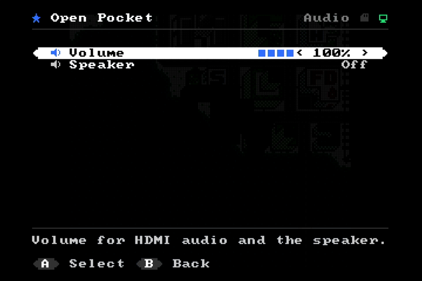

# Menu

Open the menu with **Select + Start**, board button **S1**, or `m` in the remote. The game pauses, the picture dims and audio is muted. **START** or **B** on the main page returns to the game.


The menu is drawn by the firmware in `fw/src/main.c` on a 42 × 24 cell OSD (16 × 20 px cells with a colour per cell) and, in a compact 16 × 16 form, on the SPI LCD.

| Main page | Display | Audio | Info |
|---|---|---|---|
|  |  |  |  |

**Navigation:** up / down moves the bar, left / right changes a value, A selects, B goes back. L / R on a DualShock jump a page in long lists.

## Pages

| Page | Item | Values | What it does |
|---|---|---|---|
| Main | Resume | | back to the game |
| | Library | | SD card or internal flash |
| | Save Game | | write the cartridge save now (shown only for battery-backed carts) |
| | Reset Game | | restart the game; the save is written first |
| | Sleep | | pause, switch off HDMI and the LCD; any button wakes it up |
| Library | SD Card | | browse the card: folders, `.gb` `.gbc` `.sgb`, sizes. A on a file offers **Play** and **Write to Cartridge** |
| | Internal Flash | | games written with `tools/make_games.py` |
| | Cartridge | | the external W25Qxx flash: Play, chip info, Erase |
| Display | Display Mode | Original / Pixel Grid / Scanlines | HDMI pixel style |
| | DMG Palette | Gray / Green / Pocket / Light / Amber | colours for DMG games |
| | GBC Colors | Corrected / Raw | GBC LCD colour correction |
| | HDMI Output | On / Off | Off powers down the HDMI PLL |
| | SPI LCD | On / Off | Off holds the LCD in reset with the backlight off |
| | LCD Scaling | Fit / Crop | see [hardware.md](hardware.md#st7735s-lcd) |
| | LCD Backlight | 25 / 50 / 75 / 100 % | PWM on the BL pin |
| | Debug Overlay | Off / On | status lines, see below |
| Audio | Volume | Mute … 100 % | HDMI audio and the speaker |
| | Speaker | Off / On | sigma-delta audio on pins 76 / 75 |
| | Speaker Boost | x1 / x2 / x4 / x8 | extra gain for the speaker after DC removal (default x4) |
| Controls | Swap A / B | Off / On | |
| System | Model | Auto / Game Boy Color / Game Boy | applies when the game is reset |
| | Autosave | On / Off | |
| | Save Notifications | On / Off | "Saved" toast over the game |
| | Start-up | Last Game / Menu | what happens at power-up |
| | Sleep Timer | Off / 5 / 15 / 30 min | sleep after that long without a button press |
| | Power Mode | Normal / Battery | see below; hold **S2** for 1 s to toggle |
| | Activity LEDs | Off / On | LED0 while loading, LED1 in the menu |
| | Reset Settings | | defaults (the last game is kept) |
| Info | | | game, cartridge, ROM and save size, mode, source, SD card size, flash ID, uptime, firmware |

All settings are stored in the SPI flash at 0x7FF000 when the menu closes.

## Saves

| Game from | Save goes to | When |
|---|---|---|
| SD card | `<rom name>.sav` next to the ROM (same format as other emulators) | 2 s after the game last wrote its cartridge RAM, when the menu opens, before a reset or another game is loaded, and before sleep |
| internal flash | slot *n* at 0x600000 + *n* × 0x22000 (header sector + up to 128 KB) | same; only 4 KB sectors that changed are erased and written |

The hardware sets a flag on every cartridge RAM write; the firmware polls it while the game runs. Saves are read back into SDRAM when the game is loaded. MBC3 real-time clocks and MBC7 EEPROMs are not saved.

## Battery mode

System → Power Mode = **Battery**, or hold **S2** for 1 s (a short S2 still resets the game). Everything that is not needed to play on the SPI LCD is switched off:

| | Normal | Battery |
|---|---|---|
| HDMI | on | off: PLL powered down, TMDS outputs tri-stated (no current into the TV's termination), no framebuffer writes to SDRAM |
| LCD backlight | setting | at most 25 %, almost dark after 30 s without a button press, any button restores it |
| LEDs, debug lines | setting | off |
| Sleep timer | setting | 5 min when the setting is Off |
| menu CPU | wakes every 200 ms | every 500 ms |

Hold **S1** to leave Battery mode with HDMI on (useful without an LCD). The board's BL616 USB chip and power LED are outside the FPGA's control; for the longest run, power the board through the 5 V pin instead of USB-C, so the BL616 has no USB host to talk to.

## Saves on the cartridge

The cartridge flash (W25Q16 … W25Q128, size from the JEDEC ID) holds a header sector at 0, the ROM at 0x10000 and the save at the end of the chip (header sector + up to 128 KB). *Write to Cartridge* copies the ROM and the `.sav` from the SD card, checks every 64 KB block and starts the game from the cartridge; its saves are written back to the chip.

## Power saving

| Measure | How |
|---|---|
| HDMI off | **hold S1 for 1 s** (works in game, shows a toast when switching on) or Display → HDMI Output. The HDMI PLL is powered down (`RESET_P`), the 135 MHz serializer clock stops, the TMDS outputs are tri-stated and the framebuffer is no longer written. |
| Battery mode | all of the measures in one switch, see above |
| LCD off / dimmer | Display → SPI LCD, LCD Backlight |
| Sleep | Main → Sleep or System → Sleep Timer: core paused, HDMI and LCD off, LEDs off |
| Idle menu CPU | the firmware waits on `REG_WAIT`; the CPU stalls in a bus cycle until an input changes or the timeout (100–200 ms during play) passes |
| Flash | deep power-down (0xB9) after every access |
| LEDs, RGB LED | off unless enabled; the WS2812 data pin is held low |

The current draw was not measured.

## Debug overlay


With *Debug Overlay = On*, the HDMI picture gets two status lines in the black border (written by the firmware four times a second):

```
FPS 60  GBC 2X  PAD -D-----S  UP 00:05:23
uCity                    MBC5     128K
```

| Field | Meaning |
|---|---|
| `FPS` | frames the Game Boy LCD produced in the last second |
| `GBC` / `DMG` | mode the core runs in |
| `1X` / `2X` | CPU speed (GBC double-speed mode) |
| `PAD UDLRABsS` | live button state: Up, Down, Left, Right, A, B, select, Start (`-` = released) |
| `UP hh:mm:ss` | time since power-up |
| second line | game name, mapper, ROM size; `*` while a save is pending |

The SPI LCD shows a compact version in its top text row.
